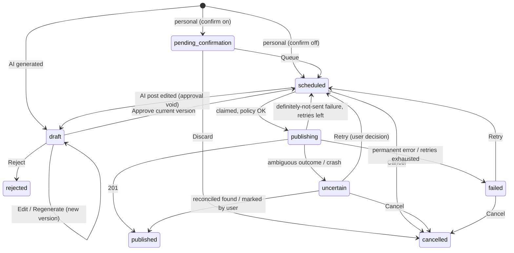

# Implementation Plan — Personal X Posting Agent

Last updated: 2026-10-12

## Progress

| Milestone | Status |
|---|---|
| 0 — Repository inspection & technical plan | Done (defaults in §14 applied) |
| 1 — Project foundations | Done, 2026-10-12 |
| 2 — Telegram & personal post queue | Done, 2026-10-12 |
| 3 — X API integration & scheduling | Done, 2026-10-12 |
| 4 — AI editorial engine | Done, 2026-10-13 |
| 5 — Telegram approval workflow | Not started |
| 6 — Production hardening & open-source release | Not started |

### Milestone log

**M1 (2026-10-12).**
- **Delivered:** pnpm + TypeScript 7 (strict, type-check only), Biome, Vitest 5, config loading and validation, the full schema with migration `0000_initial_schema`, a Pino logger with secret redaction, `init:local`, `check:secrets`, `db:migrate`, the examples and a README.
- **Verification:**
  - 112 tests pass.
  - With no config, startup lists every problem and exits 78.
  - With valid config, it logs "ready" and exits 0 on SIGINT.
  - After `init:local`, `.env` and `local/` don't appear in `git status`.
  - The secrets scan catches a planted key.
- **Decisions made during M1:**
  - **Supply chain:** pnpm `minimumReleaseAge: 1440` refuses packages published less than 24 hours ago.
  - **Env precedence:** real environment variables override `.env`.
  - **Demo profile:** used only when `paths.profileDir` points at `examples/profile`. Otherwise the agent refuses to start while any profile file still contains the `example-profile` marker.
  - **Root path:** the project root is derived from the code location, not the working directory.
  - **AI models:** `ai.models` is always required (even with `ai.enabled: false`) to keep the config type simple.
  - **License:** left as `UNLICENSED` until you choose one (before M6).

**M2 (2026-10-12).**
- **Delivered:**
  - grammY bot with allowlist and private-chat middleware.
  - Commands: `/start` `/help` `/add` `/queue` `/cancel` `/status` `/pause` `/resume`.
  - Text intake with a preview and [Queue]/[Discard] buttons that carry the post version.
  - Pure timezone-aware slot generation, text analysis (`twitter-text` weighting, URL policy, secret warnings) and the post transition table.
  - Queue and scheduler services, a notifier port with a Telegram adapter (startup notification), and `pnpm telegram:whoami`.
- **Verification:**
  - 216 tests pass, including 14 end-to-end bot tests (real handlers and SQLite, recorded Bot API).
  - A live smoke test against the real bot worked: token accepted, polling, startup notification delivered, clean SIGINT exit.
  - A fake token exits 78 with a fix message.
- **Decisions made during M2:**
  - **When a slot is booked:** slots are booked at confirmation, inside an immediate transaction. The time shown in the preview is a projection.
  - **Which windows are used:** each day uses the first `postsPerDay` windows.
  - **Infeasible windows:** config validation and slot generation share `findInfeasibleWindow`.
  - **Forced confirmation:** warnings (links, possible credentials) force the confirmation step even when `confirmPersonalPosts: false`.
  - **What can be cancelled:** `pending_confirmation`, `scheduled` and `failed` posts. Cancelling frees the slot through the partial unique index.
  - **Edited Telegram messages:** not applied. The bot explains how to cancel and resend.
  - **Startup notification:** controlled by `telegram.notifyOnStartup` (default true).
  - **`twitter-text` dependency:** it pulls in the deprecated `core-js@2`, whose install script is ignored.
- **Known limitations, addressed in M3:**
  - Nothing is published yet, so `/pause` only records the state.
  - Overdue posts are not yet moved to new slots.
  - There is no single-instance lease yet. A second instance is only caught by Telegram's 409 conflict.

**M3 (2026-10-12).**
- **SDK spike:** I tested `@xdevplatform/xdk` 0.6.6 against a local fake server.
  - Its `retry` option defaults to `true` but is not used in 0.6.6.
  - HTTP errors come back as `ApiError` with status and headers.
  - Network, timeout and parse failures come back as status 0, with the original error in `data`. That's enough to tell "never sent" (ECONNREFUSED, ENOTFOUND, connect timeout, TLS) from "unknown" (timeout, reset, unreadable 201).
  - The OAuth 1.0a signature correctly leaves the JSON body out.
  - **Decision:** keep the official SDK, pinned to exactly 0.6.6, with `retry: false`, plus `tests/x-client.contract.test.ts` against a local server so an SDK upgrade can't silently change behaviour.
- **Delivered:**
  - `XClient` port with a live (SDK) adapter and a dry-run adapter.
  - Error classifier (5xx, 408, timeouts and duplicate content are all treated as **unknown**).
  - `PublicationPolicy`: the single publishability rule, including the AI approval invariant.
  - Publisher (claim → send → record, at most one post per tick), reconciler (owned timeline reads, matching normalized text), outcome notifications (built from the attempts table, redelivered when they fail), overdue rescheduling, instance lease.
  - 30-second ticker, Telegram alert buttons (Publish again / It is on X / Cancel), `schedule:preview`, `x:verify`.
- **Verification:**
  - 318 tests pass, including 15 contract tests against a local HTTP server, and the "two concurrent ticks claim once", crash-recovery and AI-approval invariant tests.
  - An end-to-end dry-run smoke test with the real process and bot (on a scratch database) worked: claimed, simulated, recorded, notification delivered, lease released.
  - **Not yet verified against the real X API** (that needs your credentials).
- **Decisions made during M3:**
  - **Integrity blocks:** a post that fails a check before sending (stale version, altered text, open attempt) leaves the schedule. An AI post with an approval problem goes back to `draft`; anything else becomes `failed`. This needed the new `scheduled → failed` transition.
  - **User decisions on uncertain posts:** retry, mark as published, or cancel. Each closes the open attempt with `error_code = resolved_by_user`. Uncertain posts can now be cancelled.
  - **X account cache:** stored with a non-reversible fingerprint of the credentials, and checked at live startup. That costs one paid request per credentials change.
  - **Lease:** expires after 90 s. At startup the agent waits for a stale lease to expire (normal after a crash) before giving up.
  - **Dry run:** a dry-run publication consumes the post, which is documented. An interrupted dry-run attempt is rescheduled silently, since nothing was ever sent.
- **Known limitations:**
  - Reconciliation of Premium long posts relies on a prefix match of the possibly truncated `text`.
  - "Moved overdue posts" notifications are best effort (not stored).
  - Live publication still needs your credentials and an explicitly approved test post.

**M4 (2026-10-13).**
- **Delivered:**
  - Profile context: labelled sections stating what each may be used for (VERIFIED FACTS, OPINIONS, examples as style only…), with comments stripped.
  - Strict prompt renderer (missing variables refused; local overrides; template hash recorded).
  - `LlmClient` port with an OpenAI adapter: Responses API, Structured Outputs via Zod, `store: false`, a prompt-cache key per task, typed errors for refusal, cut-off answer, invalid output, auth, rate limit and timeout.
  - Idea generation with content-mix guidance, language filter and duplicate/cooldown filters.
  - Draft generation with deterministic checks and automatic revision, giving the model the reasons and its previous draft.
  - Advisory editor evaluation: an unsupported claim or a "discard" triggers a revision.
  - Regeneration (new version; approval of the previous version void; refused if the author changed the post meantime).
  - `job_runs` records; `pnpm ai:ideas` and `pnpm ai:draft`.
  - Final prompt templates.
- **Verification:**
  - 364 tests pass, including an OpenAI contract test against a local fake Responses API and a test that each template uses exactly the variables the service provides.
  - An AI draft is never claimable without an approval (policy test).
  - Both CLI commands ran end to end through the real SDK against a local fake server, including one automatic revision.
  - **Not yet run against the real OpenAI API** (no key in `.env`).
- **Decisions made during M4:**
  - **Checks that force a revision:** credentials, banned phrases, hashtag/emoji limits, language, duplicates and unsupported claims are errors.
  - **Checks that only warn:** links, avoided topics, repetitive openings and the editor's notes.
  - **If the review call fails:** the draft is kept, with a warning.
  - **Persistence:** drafts are persisted only after passing the checks; failures store nothing (the job run records them).
  - **Profile changes:** the profile is read at startup, so changes need a restart.
  - **Config:** `ai.requestTimeoutSeconds` added; the reasoning effort list gained `max`.
- **Not in M4 (M5):** Telegram review cards, `/ideas`, `/drafts`, approvals, the daily automatic generation job.

---

## 1. Current state

- The directory is empty and not a git repository, so this is a greenfield project with no existing conventions to preserve.
- Dev machine toolchain: Node 24.16.0 (native TypeScript type stripping works without flags; `node:sqlite` is available), pnpm 10.33, npm 11.13, Docker 28.4, git 2.50.

## 2. External constraints checked on 2026-10-12

### X API
- **Pricing is pay-per-use with prepaid credits.** The docs don't list a free tier for new developers. Spending caps can be set in the X Developer Console.
  - Create a post: $0.015 per request.
  - Create a post that contains a URL: **$0.200 per request**, 13× the plain price.
  - Owned reads (`GET /2/users/{id}/tweets`): $0.001 per post returned. Used for reconciliation.
  - User read: $0.010.
  - At 3 posts/day with no links, X costs about $1.35/month.
- **Auth:** `POST /2/tweets` accepts OAuth 1.0a user context or OAuth 2.0 user context (scopes `tweet.read tweet.write users.read`).
  - OAuth 2.0 access tokens expire after 2 hours.
  - OAuth 2.0 refresh needs the `offline.access` scope, and refresh tokens rotate.
- **No idempotency key on `POST /2/tweets`.** X rejects recent exact-duplicate text with a 403, but the time window is undocumented. That makes it a useful signal, not a guarantee.
- **`made_with_ai`** in the request body labels AI-generated *media*. It doesn't apply to text-only posts, so we won't set it.
- **Character counting is weighted:**
  - Most Latin characters count 1. CJK, emoji and other characters count 2.
  - Every URL counts 23.
  - Text is NFC-normalized before counting.
  - The standard limit is 280. Premium accounts can post longer, so the limit is configurable.
  - X recommends `twitter-text` `parseTweet`. Its npm package (v3.1.0) hasn't had a release since 2020.
- **Official TypeScript SDK:** `@xdevplatform/xdk` v0.6.6 (pre-1.0).
  - Supports OAuth1 and OAuth2.
  - `ApiError` exposes `status` and `headers`.
  - Timeout and AbortSignal behaviour is undocumented.

### OpenAI
- We'll use the Responses API with `client.responses.parse()` and `zodTextFormat` (`openai@7.32`).
- Current models: `gpt-6-astra` (flagship), `gpt-6.1-sol` (balanced), `gpt-6-luna` (cheap).
- Model IDs live in config and are never hard-coded.

### Libraries (latest stable versions)
- drizzle-orm 0.45.4 / drizzle-kit 0.31.11. The `node:sqlite` driver exists only in the 1.0 RC.
- better-sqlite3 13.0.3, grammY 1.46, zod 4.6, pino 10.4, vitest 5.0, TypeScript 7.0, Biome 2.5.

## 3. Key decisions

| # | Decision | Choice | Rationale and trade-off |
|---|---|---|---|
| D1 | X auth | **OAuth 1.0a user context.** You generate API key/secret and access token/secret in the console for your own account. | Tokens don't expire, there's no callback server, and there's no rotating refresh token to lose if the process crashes mid-refresh. Trade-off: X is pushing OAuth 2.0, so auth sits behind an interface and an OAuth 2.0 PKCE provider can be added later. |
| D2 | X client | **`@xdevplatform/xdk` behind an `XClient` port**, confirmed by a spike at the start of M3. | The spike checks two things: that we can enforce a timeout, and that we can tell "request never sent" apart from "sent, but no response". If XDK can't, we fall back to a small fetch client with OAuth 1.0a signing for the 3 endpoints we need. Precise outcome classification matters more than SDK convenience. |
| D3 | SQLite driver | **better-sqlite3 with drizzle 0.45 (stable)** | Its synchronous API gives short atomic transactions for claiming and approving. No transaction ever spans a network call. Revisit `node:sqlite` once drizzle 1.0 is stable. |
| D4 | Scheduling | **No cron library.** A single DB-driven ticker runs every 30 s. | The ticker does three things: publishes due posts, reconciles uncertain attempts, and runs daily jobs keyed in `job_runs`. All state is in the DB, so it survives restarts and catches up on missed runs. node-cron keeps schedules in memory and silently skips runs during downtime. |
| D5 | Time | **Luxon.** The DB stores UTC epoch milliseconds. | Conversion to the configured timezone happens only at the edges (display and slot computation). |
| D6 | Running TypeScript | **Node 24 native type stripping** (`node src/main.ts`). `tsc --noEmit` handles type checking. | No build step, no tsx. Requires `erasableSyntaxOnly` (no enums, namespaces or parameter properties) and `.ts` import extensions. |
| D7 | Lint and format | **Biome** | One fast tool that doesn't depend on the TypeScript compiler API, so it works with TS 7. Trade-off: fewer type-aware rules than typescript-eslint; strict `tsc` covers the gap. |
| D8 | Package manager | **pnpm** | Lifecycle scripts are blocked by default; only better-sqlite3 is explicitly allowed to run its build script. This is a supply-chain hygiene benefit for a public repo. |
| D9 | Config formats | **`.env`** for secrets and deployment settings, **YAML validated by Zod** for behaviour, **Markdown** for the editorial profile and prompt templates | Each format fits what it holds. YAML allows comments in the documented example. |
| D10 | Telegram transport | **Long polling** | No public HTTPS endpoint needed. Handlers never call OpenAI or X inline; long-running work goes to background jobs so the bot stays responsive. |
| D11 | Personal-post intake | **Plain-text message → preview with [Queue] [Discard]**. The confirmation step is on by default and can be turned off. | Without it, a stray message could be published automatically. The preview also shows the weighted length, the projected slot, a URL cost warning and a secret-pattern warning. |

## 4. Architecture

```
 Telegram (grammY) ─┐                          ┌─ Domain (pure, no I/O)
                    ├─► Application services ──┤   post states · PublicationPolicy
 Ticker (30 s) ─────┘   (use cases, short      │   slot generation · content checks
                         transactions)         └─ text weighting / hashing
                              │
              ┌───────────────┼──────────────────────────┐
         Repositories     Ports: XClient · LlmClient · Notifier · Clock
       (Drizzle/SQLite)       │
                         Adapters: XDK (live) · dry-run fake · OpenAI Responses · Telegram
```

Rules:
- **Domain is pure** and fully unit-tested.
- **One eligibility check.** `PublicationPolicy` is the only place that decides whether something can be published. It runs inside the claim transaction for every publish path.
- **Telegram handlers** only parse input, call a service and render the result. They contain no business rules.
- **External clients** only translate HTTP into typed results and errors. They never decide whether to retry.
- **Dependency injection** is manual constructor wiring in `main.ts`. No DI container.

### Directory structure

```
.
├── src/
│   ├── main.ts                  # composition root, lifecycle, graceful shutdown
│   ├── config/                  # Zod schemas (env, app config, profile), loader, error rendering
│   ├── domain/
│   │   ├── post.ts              # sources, statuses, transition table
│   │   ├── publication-policy.ts
│   │   ├── scheduling.ts        # timezone-aware slot generation (pure)
│   │   ├── text.ts              # weighted length (twitter-text wrapper), NFC, sha256
│   │   └── checks/              # length, urls, secrets, banned phrases, duplicates, repetition
│   ├── db/
│   │   ├── schema.ts
│   │   ├── client.ts            # pragmas (WAL, foreign_keys, busy_timeout), migrate on start
│   │   └── repositories/
│   ├── services/                # queue, review, scheduler, publisher, reconciler, editorial, stats
│   ├── integrations/
│   │   ├── x/                   # XClient port, live + dry-run adapters, error classifier
│   │   ├── openai/              # LlmClient port, Responses adapter, prompt renderer
│   │   └── telegram/            # bot, auth middleware, commands, callbacks, views
│   ├── jobs/ticker.ts
│   └── shared/                  # logger + redaction, clock, ids, errors
├── drizzle/                     # generated SQL migrations (committed)
├── prompts/                     # generic templates with {{placeholders}}, no personal data
├── config/agent.example.yaml    # fully documented, fictional values
├── examples/profile/            # fictional demo persona
├── local/                       # GITIGNORED: your config, profile, DB, backups, prompt overrides
├── docs/                        # setup guides: telegram, x-api, openai, deployment, operations, security
├── tests/                       # integration tests (unit tests colocated as *.test.ts)
├── .env.example · .gitignore · Dockerfile · compose.yaml · biome.json · drizzle.config.ts · tsconfig.json
└── IMPLEMENTATION_PLAN.md
```

Two changes from the original sketch:
- Zod schemas and defaults are source code, so they live in `src/config/`. The top-level `config/` directory holds only the example file.
- All private runtime data lives in one gitignored `local/` directory. That means one ignore rule, one Docker volume and one thing to back up.

## 5. Configuration and public-repository safety

| Layer | Location | Committed? | Contents |
|---|---|---|---|
| Secrets / deployment | `.env` | No (`.env.example` is) | Telegram token, allowed user IDs, OpenAI key, X keys/tokens, `DATABASE_PATH`, `PUBLISH_MODE`, `LOG_LEVEL`, `APP_CONFIG_PATH` |
| Behaviour | `local/agent.yaml` | No (`config/agent.example.yaml` is) | Timezone, posts/day, windows, min gap, lateness tolerance, model IDs per task, reasoning effort, language policy, content mix, topics to cover/avoid, banned phrases, hashtag/emoji limits, URL policy, max weighted length, check thresholds, retry/reconcile settings |
| Editorial profile | `local/profile/*.md` | No (`examples/profile/` is) | `identity.md`, `facts.md` (verified facts and projects), `opinions.md`, `voice.md`, `past-posts.md`, `rules.md` |
| Prompt templates | `prompts/*.md` (overridable via `local/prompts/`) | Yes (generic only) | Instructions with `{{profile.facts}}`-style placeholders. Rendering fails if a variable is missing. |

### Startup sequence

1. Parse env.
2. Load and validate the YAML config.
3. Load the profile (required only if `ai.enabled`).
4. Run cross-field checks, for example:
   - posts/day must not exceed the number of windows.
   - X credentials are required only when `PUBLISH_MODE=live`.
   - The OpenAI key is required only when `ai.enabled`.
5. Open the DB and apply migrations.
6. Acquire the single-instance lease.
7. Start Telegram and the ticker.

If any of steps 1–6 fails:
- Every problem is listed at once: what is wrong, where, how to fix it, and which doc covers it.
- The process exits with code 78 and nothing is started.
- A missing profile points to `pnpm init:local`, which copies the example files into `local/`.
- The demo profile is used only when explicitly selected, never as a silent fallback.

### Hard invariants (enforced in code with no config switch, and covered by tests)

- An AI post is publishable only with an approval for its **current version** whose content hash matches the exact text being sent.
- The app never modifies personal post text.
- Only allowlisted Telegram user IDs, in private chats, can trigger any action.
- `PUBLISH_MODE` defaults to `dry-run`. `live` must be set explicitly and requires valid X credentials.

### Secret hygiene

- `.gitignore` covers `.env*` (except `.env.example`), `local/`, `*.db*`, `*.sqlite*`, backups, logs, coverage and `node_modules`.
- Pino redaction paths, plus a scrubber that replaces every loaded secret value in log lines and error messages.
- Post text is never logged at info level; logs use public IDs instead.
- Content checks flag secret-looking strings in drafts and personal posts: key patterns, private-key headers, and the app's own configured secrets.
- `pnpm check:secrets` scans tracked files. gitleaks runs over full history before release (M6).
- `docs/security.md` explains how to revoke and rotate each credential: BotFather `/revoke`, regenerating X keys, revoking OpenAI keys.
- Getting your Telegram ID: `pnpm telegram:whoami` starts the bot and prints the sender's ID to the **local console**. Unauthorized users never get a reply.

## 6. Data model

All timestamps are `INTEGER` UTC epoch milliseconds. Enum columns use `CHECK` constraints. Foreign keys are on and the DB runs in WAL mode.

```
ideas 1──* posts 1──* post_versions 1──0..1 approvals
                 1──* publication_attempts *──1 post_versions
job_runs, settings (standalone)
```

| Table | Key columns |
|---|---|
| `posts` | `id`, `public_id` (6-char, unique, shown in Telegram), `source` (`personal`/`ai`), `status`, `current_version`, `language?`, `idea_id?`, `scheduled_at?`, `slot_key?`, `retry_count`, `last_error?`, `x_post_id?` (unique), `published_at?`, `review_chat_id?`/`review_message_id?`, `created_at`, `updated_at` |
| `post_versions` | `id`, `post_id`, `version`, `text` (verbatim), `content_hash` (sha256), `weighted_length`, `origin` (`user_submitted`/`user_edited`/`ai_generated`/`ai_regenerated`), `checks` (JSON: warnings, scores, claim audit), `generation` (JSON: model, template hash, token usage), `created_at` |
| `approvals` | `id`, `post_id`, `post_version_id`, `content_hash`, `decision` (`approved`/`rejected`), `telegram_user_id`, `decided_at` |
| `publication_attempts` | `id`, `post_id`, `post_version_id`, `content_hash`, `status` (`in_flight`/`succeeded`/`failed_retryable`/`failed_permanent`/`unknown`/`reconciled_found`/`reconciled_not_found`), `dry_run`, `started_at`, `finished_at?`, `http_status?`, `error_code?`, `error_message?` (sanitized), `x_post_id?`, `retry_after?`, `reconcile_checks`, `last_reconciled_at?`, `notified_at?` |
| `ideas` | `id`, `public_id`, `topic`, `angle`, `category`, `language`, `rationale`, `profile_refs` (JSON), `fingerprint`, `status` (`new`/`drafted`/`discarded`), `job_run_id?`, `created_at` |
| `job_runs` | `id`, `job_name`, `run_key` (e.g. `daily-drafts:2026-10-12`), `status`, `started_at`, `finished_at?`, `error?`, `meta` (JSON: counts, token usage) |
| `settings` | `key` (PK), `value` (JSON), `updated_at`. Holds `publication_paused`, `instance_lease`, `x_user_id`. |

Tables deliberately not created:
- `editorial_profiles`: the files are the source of truth.
- `post_metrics`: post-MVP. Owned reads at $0.001/post make it cheap to add later.
- A slots table: slots are derived deterministically (§8).

### Constraints that enforce invariants

- `post_versions UNIQUE(post_id, version)`
- `approvals UNIQUE(post_version_id)`: a double click can't create two decisions, and an edit creates a new version that needs a fresh decision.
- `publication_attempts` partial `UNIQUE(post_id) WHERE status IN ('in_flight','unknown')`: at most one open attempt per post.
- `posts UNIQUE(x_post_id)`
- `posts` partial `UNIQUE(slot_key) WHERE status IN ('scheduled','publishing','uncertain','published')`: a slot can't be booked twice.
- `job_runs UNIQUE(job_name, run_key)`: daily jobs run once per local day, even across restarts.
- Index on `posts(status, scheduled_at)`.

### Post state machine



A personal post edited while scheduled stays `scheduled` with a new version; it needs no approval. The transition table lives in `domain/post.ts`, and every service mutation goes through it.

## 7. Publication reliability

### Publish cycle for each due post

1. **Claim.** One short synchronous transaction:
   1. Re-read the post.
   2. Run `PublicationPolicy.check()`. It requires all of the following:
      - status is `scheduled` and the post is due
      - publishing isn't paused
      - the publish mode is valid
      - an AI post has a valid approval for its current version and hash
      - no attempt is open
   3. Insert an `in_flight` attempt with the version ID and hash.
   4. Set the post to `publishing`.
   5. Commit.
2. **Send.** Call X outside any transaction, with a timeout.
3. **Record.** Classify the outcome and record it in a second short transaction:

| Outcome | Examples | Attempt | Post |
|---|---|---|---|
| Success | 201 | `succeeded` + `x_post_id` | `published` |
| Not created, transient | 429; connection refused / DNS / TLS failure before the request was sent | `failed_retryable` | `scheduled`, with backoff. For 429, retry after `x-rate-limit-reset`. Max N retries. |
| Not created, permanent | 400 validation; 401/403 auth or permission | `failed_permanent` | `failed`, plus a notification with a fix hint |
| Duplicate-content 403 | | `unknown` | `uncertain`. This strongly suggests the post already exists, so we reconcile. |
| Ambiguous | timeout after send, socket reset, any 5xx | `unknown` | `uncertain`. **Never retried automatically.** |

4. **Reconcile** (run by the ticker):
   - After a delay, read your own timeline from `started_at − 2 min` (an owned read).
   - Match on normalized text: NFC, whitespace, URLs replaced by a placeholder (t.co), decoded HTML entities, and `note_tweet` for long posts.
   - Found: mark `published` and store the post ID.
   - Not found after K checks over about 15 minutes: notify you with [Retry] [Mark published] [Cancel].
   - Retry after "not found" is automatic only if `reconcile.autoRetryIfNotFound: true` (default `false`).
5. **Restart recovery.** Any attempt still `in_flight` at startup becomes `unknown` and goes through reconciliation. Terminal attempts with no `notified_at` are re-notified.
6. **Single instance.** A lease row in `settings` with a heartbeat makes a second instance refuse to start. Telegram's `getUpdates` 409 conflict is a second signal.
7. **Notifications are best-effort with retry** (via `notified_at`). Publishing never depends on Telegram being up.

### Documented limitation

Exactly-once publication is impossible without an idempotency key. The plan guarantees two things:
- At most one *automatic* send per post version.
- A human decision for any outcome we can't confirm.

### Dry-run mode

- `PUBLISH_MODE=dry-run` (the default) swaps in a fake `XClient`. It never touches the network, flags attempts with `dry_run=1`, and tags Telegram notifications `[DRY RUN]`.
- The fake can simulate timeouts, 429s and 5xx errors on demand.
- `pnpm schedule:preview` prints the projected schedule without changing anything.
- Recommended: point `DATABASE_PATH` at a separate DB for experiments.

## 8. Scheduling

- **Config:** `timezone` (example `Africa/Abidjan`), `postsPerDay` (3), `windows` (local `HH:mm` ranges), `activeDays`, `minGapMinutes`, `maxLatenessMinutes`.
- **Slots for a local date:**
  - Each of the first `postsPerDay` windows gets one time inside it.
  - The time uses a deterministic jitter, `hash(installSalt, date, windowIndex)`, clamped to respect `minGapMinutes`.
  - Slots are stable across restarts without being stored, and vary from day to day.
  - `slot_key` = `2026-10-14#1`.
- **Allocation:**
  - Happens when a post becomes eligible: a personal post is queued, or an AI post is approved.
  - The post gets the earliest free future slot (FIFO).
  - Allocation runs in one transaction, with the partial unique index as a backstop.
- **Ticker:** claims posts whose `scheduled_at` ≤ now.
  - When paused, it claims nothing.
  - Posts overdue by more than `maxLatenessMinutes` (after a pause or downtime) are moved, in order, to the next free slots instead of being published in a burst.
- **Empty slots stay empty.** There is no filler content.
- **DST:** Luxon handles it. Tests run under `Europe/Paris` to exercise DST transitions, since Abidjan is UTC+0 with no DST.
- **Daily AI job:** at `ai.autoGenerate.at` local time, it generates drafts only for upcoming free slots, capped at `maxPendingDrafts`.

## 9. Editorial engine

- **Profile assembly.** Profile files become labelled prompt sections:
  - **VERIFIED FACTS**: may be stated.
  - **OPINIONS**: may be expressed as the author's view.
  - **VOICE**
  - **EXAMPLES**: style reference only, never copied.
  - **RULES / AVOID**

  The static profile goes first in the prompt so it benefits from OpenAI's automatic prompt caching.
- **Pipeline:**
  1. **Ideas.** Inputs: the profile, recent topics and the gap against the target content mix. Structured output: `{topic, angle, category, language, rationale, profileRefs}[]`. Ideas are deduplicated and stored.
  2. **Draft.** Structured output: `{text, language, claims[{text, basis: profile_fact | profile_opinion | general_knowledge | unsupported}]}`.
  3. **Deterministic checks:**
     - empty text and weighted length
     - URL policy and cost
     - banned phrases, hashtag and emoji limits
     - secrets
     - exact and near duplicates (trigram Jaccard against the last N posts, including scheduled posts and drafts)
     - repeated openings and topic cooldown
  4. **AI evaluation** (cheaper model): rubric scores, claim audit and a list of issues. This is **advisory only.**
  5. **Failure handling.** A hard failure triggers automatic regeneration, up to N times; after that the draft is discarded and you're notified. Soft warnings appear on the review card.
  6. **Storage.** The draft is stored as `posts(source=ai, status=draft)` with version 1, and a review card is sent to Telegram.
- **Language:** chosen per idea from the `editorial.languages` policy. Each post has one language, with no automatic translation.
- **Personal posts get only non-mutating checks.**
  - A length the X API would reject is a hard block.
  - Secret patterns and URL cost produce warnings that need explicit confirmation.
- **LLM calls:** `responses.parse` + `zodTextFormat`, with `store: false`.
  - Model and reasoning effort are set per task in config.
  - Token usage is recorded in `job_runs.meta`.
  - SDK retries are safe here because LLM calls have no side effects.

## 10. Telegram UX

- **Commands:** `/start`, `/help`, `/add`, `/queue`, `/drafts`, `/ideas`, `/cancel <id>`, `/pause`, `/resume`, `/status` (mode, pause state, next slot, items needing attention), `/stats`.
- **Inline buttons:**
  - Review card: [✅ Approve] [✏️ Edit] [🔄 Regenerate] [❌ Reject]
  - Personal preview: [Queue] [Discard]
  - Uncertain or failed alert: [Retry] [Mark published] [Cancel]
  - Idea list: [Draft n]
- **Callback data** is `<action>:<publicId>:<version>` (≤ 64 bytes). Every callback goes through:
  1. Authorization.
  2. A service call that checks state and version inside a transaction.
  3. An idempotent reply: a repeat click gets "Already approved". A stale version gets "This card is outdated".

  Once a decision is made, the card is edited to remove its buttons.
- **Edit flow:**
  1. [Edit] sends a ForceReply prompt: "Editing P7K2Q v2 — reply with the full new text".
  2. The reply is parsed for the ID and version. This is stateless, so it survives restarts.
  3. The version must still be current.
  4. The new text is stored verbatim as v3, the approval resets, and a new card is sent.
- **Authorization:** middleware requires a private chat and `from.id ∈ TELEGRAM_ALLOWED_USER_IDS`. Anyone else gets no response, and only their user ID is logged.
- **Media is out of scope for the MVP.** The bot says so politely.

## 11. Risks

| Risk | Mitigation |
|---|---|
| Ambiguous publish outcome (inherent to the API) | Claim before sending, never retry blindly, reconcile against the timeline, let a human decide. |
| X pricing and access volatility. Prices changed in Feb and Apr 2026; a URL post costs 13×. | URL policy and warnings, cost figures in `/stats`, documented console spending cap, prices recorded as "as of" with links. |
| X deprecates OAuth 1.0a | Auth sits behind the `XClient` port, so an OAuth 2.0 PKCE provider can be added. |
| XDK is pre-1.0 and its API may change | Pin the version, keep it behind the port, run the M3 spike, keep the fetch fallback. |
| `twitter-text` unmaintained since 2020 | Newer emoji may be over-counted, which only rejects early and never sends something too long. It's wrapped in one function, and an X 400 for over-length is treated as a permanent failure with a notification. |
| LLM invents facts, metrics or opinions | Facts and opinions are separated in the prompt, every claim is audited and unsupported ones are flagged, and human approval is a code invariant. |
| Privacy: profile and drafts go to OpenAI; the DB holds unpublished drafts | `store: false`, documented data flow, `local/` permissions, backups gitignored. |
| X account restrictions for spammy automation | Minimum gap between posts, duplicate checks, modest volume, no automated replies or mentions. |
| Bot token leak exposes messages sent to the bot | The user-ID check still blocks approvals; rotation is documented; the bot never echoes secrets. |
| Two instances running | DB lease, Telegram 409 detection, a single replica in compose. |
| New toolchain (TS 7 native compiler, Node type stripping) | The code stays erasable-syntax, so falling back to TS 6 or a `tsc` build is cheap. |
| better-sqlite3 native module in Docker | Use `node:24-bookworm-slim` with prebuilt binaries, not Alpine. |

## 12. Milestones and acceptance criteria

### M1 — Foundations
**Scope:**
- git init and the pnpm project.
- `tsconfig`: strict, `noUncheckedIndexedAccess`, `erasableSyntaxOnly`, `verbatimModuleSyntax`.
- Biome and Vitest.
- Scripts: `dev`, `start`, `check` (typecheck + lint + test), `db:generate`, `db:migrate`, `init:local`, `check:secrets`.
- Config schemas, loader and error rendering.
- The full Drizzle schema and initial migration.
- Pino logger with redaction.
- `.env.example`, `.gitignore`, `config/agent.example.yaml`, the fictional `examples/profile/`, generic prompt skeletons and a README skeleton.

**Acceptance criteria:**
- With a valid config, `pnpm start` logs "ready" (no jobs yet) and exits cleanly on SIGINT.
- With an invalid or missing config, it lists every problem and exits with code 78.
- A fresh DB gets the full schema with constraints.
- Tests for config validation and log redaction pass.
- After `pnpm init:local`, `git status` shows no private files.

### M2 — Telegram and personal queue
**Scope:**
- grammY bot with auth middleware.
- Commands: `/start` `/help` `/add` `/queue` `/cancel` `/status` `/pause` `/resume`.
- Plain-text intake with preview and confirmation.
- Slot allocation in the pure `scheduling` module.
- The notifier port and `telegram:whoami`.

**Acceptance criteria:**
- A submitted post is queued with its slot shown in the local timezone.
- The text is stored byte-exact. Tests cover emoji, accents, newlines and leading/trailing whitespace.
- After a restart, `/queue` shows the same posts.
- Unauthorized users are ignored.
- A double [Queue] click queues the post once.
- Handler tests run against grammY with the outgoing API intercepted (no network).

### M3 — X integration and publication
**Scope:**
- Spike first: test XDK's timeout and error behaviour, then decide between XDK and the fetch fallback.
- `XClient` port with live and dry-run adapters, and the error classifier.
- `PublicationPolicy`, publisher, ticker, reconciler.
- Retry with backoff and 429 handling.
- Rescheduling of late posts.
- Instance lease.
- `schedule:preview` and `x:verify` (one `GET /2/users/me` call, which costs about $0.01).

**Acceptance criteria (tests use the fake client):**
- A due post is published exactly once.
- Concurrent or duplicate ticks don't double-publish.
- A timeout leads to `uncertain`, and both reconciliation paths (found, not found) are tested.
- A 429 is respected.
- When paused, nothing is claimed.
- A crash mid-flight leads to `uncertain` and the post is never re-sent automatically.
- **No live post goes out until you explicitly authorize a specific test post.**

### M4 — AI editorial engine
**Scope:**
- Profile loader and assembler, prompt renderer.
- `LlmClient` port and OpenAI adapter.
- Idea and draft generation, deterministic checks, the evaluator, persistence.

**Acceptance criteria:**
- With a fake LLM, generated drafts are stored as `draft`, and the publisher can never claim them (policy test).
- Checks catch over-length text, duplicates, secrets and banned phrases.
- One real OpenAI run with the demo profile, reviewed by you.

### M5 — Approval workflow
**Scope:**
- Review cards and the Approve, Edit, Regenerate and Reject actions.
- Versioning and approval invalidation.
- `/drafts` and `/ideas`.
- The daily auto-generation job.

**Acceptance criteria (tests):**
- After approving v1 and then editing, v2 isn't publishable until it is approved.
- Regenerating invalidates the approval.
- A double approve produces one approval and one slot.
- Buttons on a stale card are rejected.
- A user who isn't allowlisted can't approve.
- A content hash mismatch blocks publishing.

### M6 — Hardening and release
**Scope:**
- Dockerfile (Debian slim, non-root) and `compose.yaml` with the `local/` volume and a healthcheck.
- `db:backup` (better-sqlite3 online backup) and restore docs.
- `/stats` and failure-scenario tests.
- Full docs: install, Telegram, X, OpenAI, config reference, operations, troubleshooting, security and credential rotation.
- Demo profile polish.
- Release audit: gitleaks over history, LICENSE, CONTRIBUTING.

**Acceptance criteria:**
- From a fresh clone, following the README gets the agent running in dry-run with the demo profile, without editing source.

## 13. External setup you'll need to do

| When | Action |
|---|---|
| M2 | Create a bot with @BotFather and copy the token. Run `pnpm telegram:whoami` to get your user ID. |
| M3 | In the X Developer Console: create an app and set its permissions to **Read and Write**. Then generate the API key/secret and the access token/secret. Tokens generated *before* the permission change keep read-only access. Buy credits and set a spending cap. |
| M3 | Explicitly authorize the first live test post. |
| M4 | Create an OpenAI API key with billing enabled, and confirm which model IDs your org can use. |
| M4 | Write your real profile in `local/profile/`, starting from the templates. |

## 14. Open questions (proposed defaults in bold)

1. X auth: **OAuth 1.0a** or OAuth 2.0 PKCE?
2. Deployment target: **Docker Compose on a small Linux VPS**, systemd, or an always-on Mac?
3. Confirmation step for personal posts: **on**?
4. Is your X account Premium (posts longer than 280)? **Assume no.** The limit is configurable either way.
5. URL policy: **warn and require confirmation**, since each link post costs $0.20?
